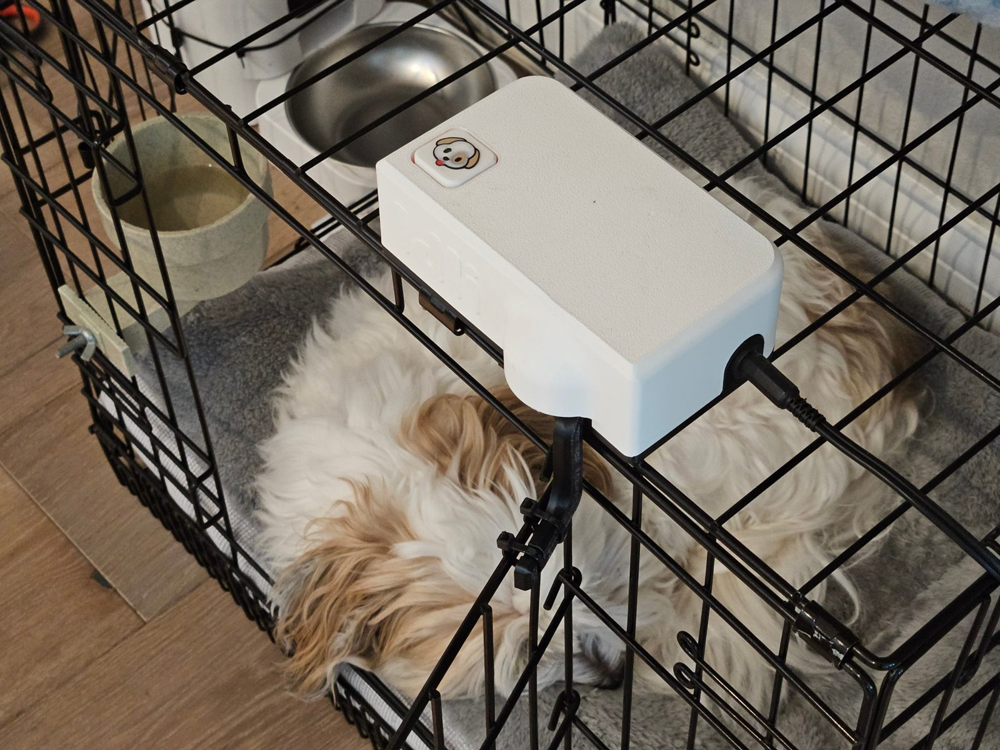
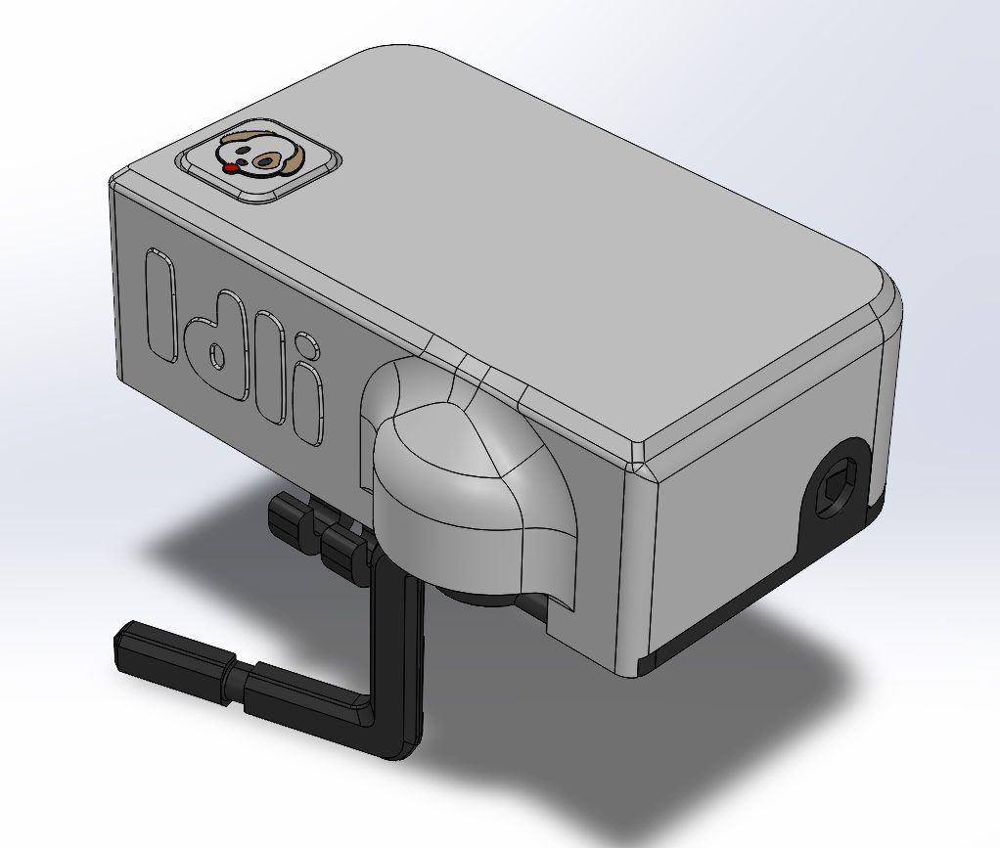
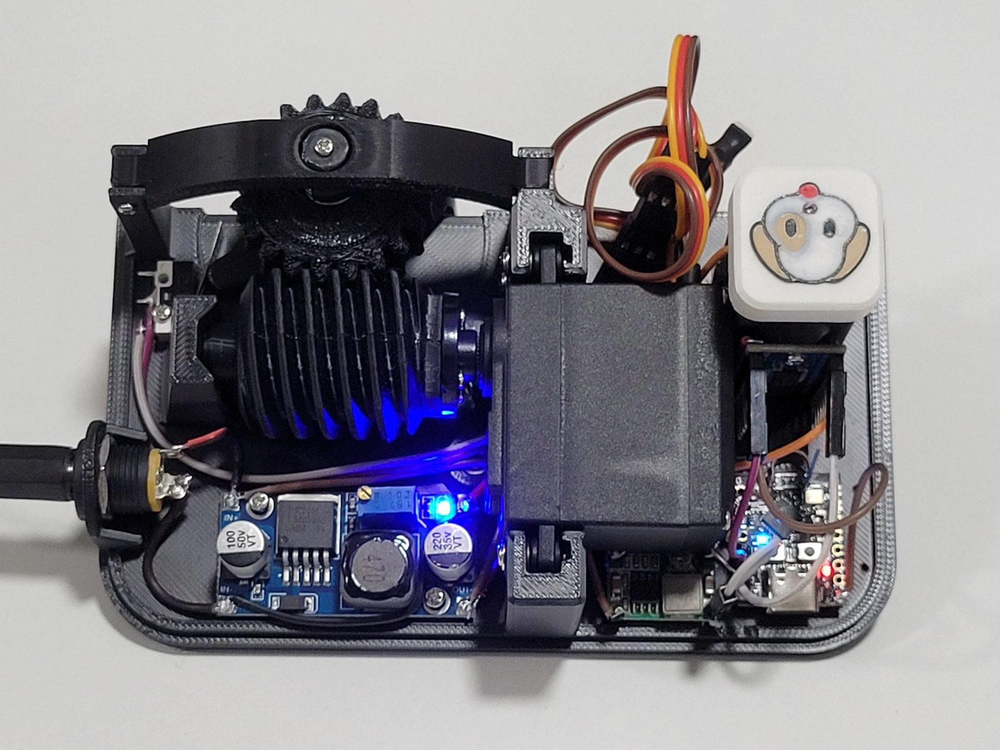
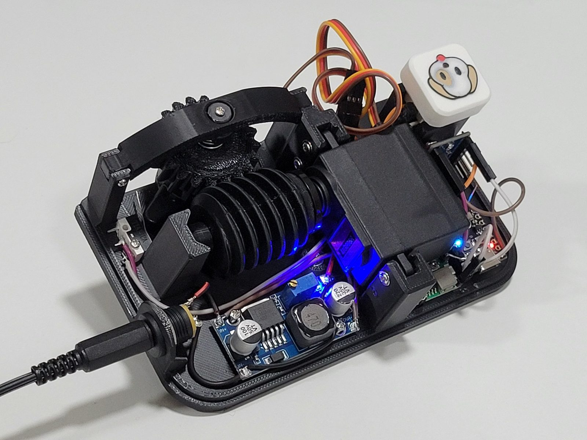
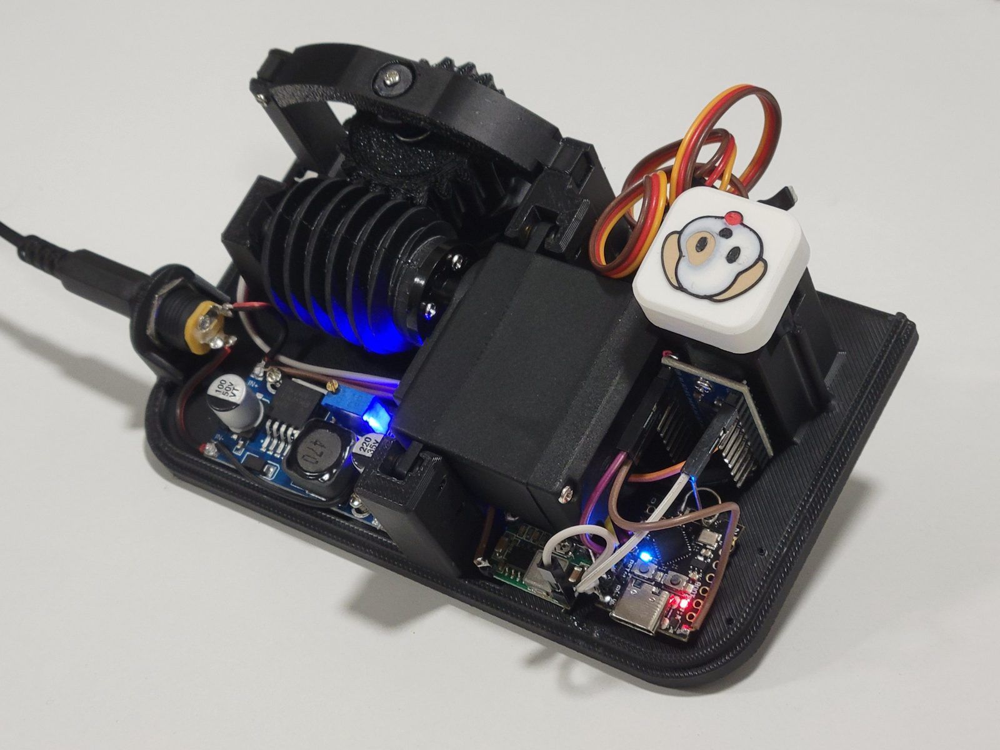

# Idli's Crate Door

A motorized dog-crate door for Idli, built on an **ESP32-C6 SuperMini** and controlled with a pushbutton or remotely through **ESP RainMaker** and **Amazon Alexa**.

A continuous-rotation MG996R servo drives the door through a worm gear and a torque-limiting clutch. Limit switches stop it at the open and closed positions, and a momentary button on top of the opener lets you operate it by hand. A long press on the button also fires a virtual contact sensor that can start any Alexa routine, such as a smart feeder.

---

## Features

- **Voice control:** the door appears in Alexa as an exterior blind, so "Alexa, open Idli's Door" and "Alexa, close Idli's Door" work without a PIN.
- **Local button** (acted on when released):
  - Short press (0.1–2 s): toggles the door.
  - Long press (2–10 s): closes the door and triggers the *Idlis Food Button* contact sensor for an Alexa routine.
  - Held over 10 s: treated as stuck (something resting on it). The press is ignored and an alert is sent.
- **Jam handling:** each move times out at 1.5× its learned travel time (7 s until learned). A timeout stops the motor, marks a fault and sends a push notification.
- **Door hold:** if the closed door is pushed open (the clutch can slip), it is re-closed with a 3 s attempt, then retries after 10, 30 and 60 s. If all fail, the motor stays off and an alert is sent.
- **Accurate state:** the position shown in Alexa and the RainMaker app follows the limit switches, not just the last command.
- **Power-up behavior:** choose whether the door stays put, closes, or returns to its last commanded state after a power cut.
- **Button lock:** disable the physical button from the app while Alexa and the app keep working.
- **Travel learning:** the controller learns normal open and close times and alerts you if the door gets noticeably slower, an early sign of binding or clutch slip.
- **Activity:** opens today, feeds today and last-opened time in the RainMaker app.
- **Over-the-air updates** through the RainMaker dashboard.

---

## Hardware

| Part | Notes |
| --- | --- |
| ESP32-C6 SuperMini | 4 MB flash |
| MG996R servo, **continuous-rotation (360°) version** | The code treats 0 / 90 / 180 as full speed one way / stop / full speed the other way |
| Worm gear and torque-limiting clutch | The worm gear holds the door when the motor is off; the clutch limits force if the door is blocked |
| 2× limit switches | Normally open, one at each end of travel |
| Momentary pushbutton | Normally open, mounted on top of the opener |
| 12 V DC adapter | Main power input through a panel-mount barrel jack |
| LM2596 buck converter, set to 6.5 V | Powers the servo (the MG996R is rated 4.8–7.2 V) |
| Mini360 buck converter, set to 5 V | Powers the ESP32-C6 SuperMini through its 5 V pin |
| Logic level shifter | Raises the ESP32's 3.3 V servo signal to a level the servo reads reliably |
| 470–1000 µF electrolytic capacitor (recommended) | Across the servo supply, close to the servo, to absorb current spikes |

### Photos

| CAD model | Inside, top view |
| --- | --- |
|  |  |

| Inside, angled | Inside, from the electronics side |
| --- | --- |
|  |  |

### Wiring

| ESP32-C6 pin | Connects to |
| --- | --- |
| GPIO1 | Servo signal, through the level shifter |
| GPIO15 | Open limit switch (other side to GND) |
| GPIO18 | Closed limit switch (other side to GND) |
| GPIO19 | Pushbutton (other side to GND) |
| GPIO8 | Onboard RGB LED (hidden in the enclosure, kept off) |
| GND | Common ground for both buck converters, the level shifter and the servo (**required**) |

All inputs use the ESP32's internal pull-ups, so a pressed or triggered switch reads `LOW`.

The servo runs from the LM2596 at 6.5 V and the ESP32 from the Mini360 at 5 V, so motor current spikes stay off the ESP32's supply. Set both converters with a meter before connecting anything; an LM2596 left at a high setting will destroy the servo.

---

## Software

### Requirements

| Component | Version |
| --- | --- |
| Arduino IDE | 2.x |
| ESP32 Arduino core (Espressif) | 3.3.12 |
| ESP32Servo (Kevin Harrington) | 3.2.1 |

ESP RainMaker, WiFiProv, Preferences and AppInsights are included with the ESP32 core.

### Board settings (Arduino IDE → Tools)

| Setting | Value |
| --- | --- |
| Board | ESP32C6 Dev Module |
| USB CDC On Boot | Enabled |
| Partition Scheme | **RainMaker 4MB** (not "No OTA" — the OTA slots are needed) |
| Erase All Flash Before Sketch Upload | Enabled for the very first upload only |

The sketch uses about 93% of the RainMaker 4MB app slot.

---

## Setup

1. **Provisioning name.** The board appears over Bluetooth as `PROV_IdliDoor` and doesn't ask for a proof-of-possession (PoP). To require one, set `pop` near the top of the sketch.
2. **Flash the board** and open the Serial Monitor at 115200 baud.
3. **Provision over Bluetooth.** In the ESP RainMaker app, tap *Add Device* and scan the QR code printed in the Serial Monitor, or pick `PROV_IdliDoor` from the list. Enter your Wi-Fi details.
4. **Set the time zone** for the node in the RainMaker app, so the daily counters reset at your local midnight.
5. **Link Alexa.** In the Alexa app, enable the *ESP RainMaker* skill, sign in, and discover devices. *Idlis Door* and *Idlis Food Button* appear; the settings device does not.

### Using the food button in an Alexa routine

In the Alexa app, go to **Routines → + → When this happens → Smart Home → Idlis Food Button** and choose **Opens**. A long press reports "open" for 2 seconds, then returns to "closed". Add any action, such as dispensing a meal from a smart feeder.

---

## RainMaker app

| Device | Item | Type | Purpose |
| --- | --- | --- | --- |
| Idlis Door | Door Postion | Slider 0–100 | Open (100) / closed (0); reads 50 if stopped between the switches |
| Idlis Food Button | Food Button State | Read-only | "Open" for 2 s after a long press |
| Idli Door Settings | Door Status | Read-only | Open, Closed, Opening, Closing, Partly open, re-close progress, or the fault |
| | Power-up Behavior | Dropdown | Stay (default), Close, or Last state |
| | Button Lock | Toggle | Ignore the physical button |
| | Opens Today / Feeds Today | Read-only | Daily counters |
| | Last Opened | Read-only | Time the door last finished opening |
| | Open Travel (s) / Close Travel (s) | Read-only | Learned baseline; 0 while learning (first 5 full moves) |
| | Reset Travel Times | Toggle (acts as a button) | Relearn after mechanical changes |
| | Firmware | Read-only | Firmware version |

"Door Postion" keeps its original spelling so existing Alexa setups keep working.

### Push notifications

| Alert | Cause |
| --- | --- |
| Jammed while opening / closing | A move didn't reach its limit switch in time |
| Pushed open and could not be re-closed | All door-hold attempts failed |
| Both limit switches are active | Wiring or switch fault |
| Button held for over 10 s | Something is resting on the button |
| Door took X s to open/close (normally Y s) | Travel 30% slower than baseline (at most once a day per direction) |

A fault clears on the next button press or Alexa/app command, or by itself if the door ends up at the requested switch (for example, shut by hand).

---

## Configuration

Timing constants are at the top of the sketch:

| Constant | Default | Purpose |
| --- | --- | --- |
| `LONG_PRESS_MS` | 2000 | Hold time for a long press |
| `STUCK_BUTTON_MS` | 10000 | Hold time treated as a stuck button |
| `MOVE_TIMEOUT_DEFAULT_MS` | 7000 | Move timeout until travel is learned |
| `MOVE_TIMEOUT_FACTOR` | 1.5 | Timeout as a multiple of learned travel time |
| `HOLD_ATTEMPT_MS` | 3000 | Each door-hold attempt |
| `HOLD_BACKOFF_MS` | 10 / 30 / 60 s | Waits before door-hold retries |
| `SLOW_FACTOR` | 1.3 | "Door getting slow" threshold |
| `service_name` | `PROV_IdliDoor` | Bluetooth name during provisioning (keep the `PROV_` prefix) |
| `pop` | none | Proof-of-possession; set a string to require one |

If the door runs the wrong way, swap `SERVO_OPEN` and `SERVO_CLOSE`, or swap the two limit-switch wires.

---

## Troubleshooting

- **Servo creeps or hums when stopped:** adjust `SERVO_STOP` (try 88–92) or the servo's centering trim.
- **Board resets when the door moves:** check the common ground between the two converters and add the bulk capacitor across the servo supply.
- **Servo twitches or ignores commands:** check the level shifter's low-voltage side is powered from 3.3 V, its high-voltage side from 5 V or the servo supply, and that it shares the common ground.
- **OTA update reverts after a reboot:** the new firmware confirms itself after 30 s on Wi-Fi; make sure it stays powered and connected that long after updating.
- **Device not found during provisioning:** check Bluetooth is on, then erase flash and reflash.
- **Alexa doesn't see the door:** confirm it's online in the RainMaker app, then run *Discover Devices* again.

---

## Safety

This is a motorized door on an animal enclosure. The torque-limiting clutch should slip before the door can hurt a paw or tail; set it with that in mind and test with something soft in the doorway. Make sure the crate can be opened by hand if the electronics or power fail.

---

## Credits

Provisioning code is based on Espressif's ESP RainMaker Arduino examples.

## License

MIT, see [LICENSE](LICENSE).
